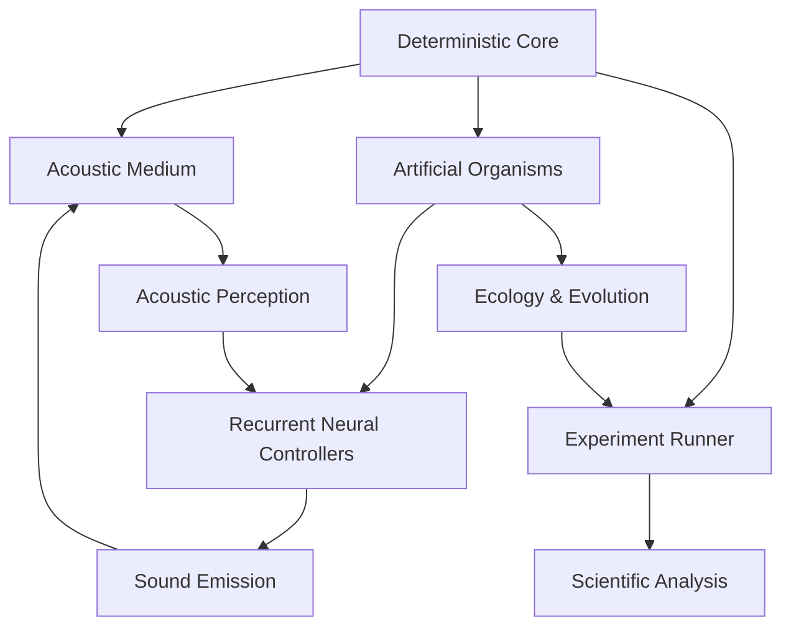

# SYNESTHESIA

<p align="center">
  <strong>Emergent Acoustic Communication Through Artificial Evolution</strong>
</p>

<p align="center">
  An experimental C++20 research project investigating whether the physical fidelity of an acoustic environment changes the signals that evolve within artificial populations.
</p>

<p align="center">
  <code>C++20</code> · <code>Computational Acoustics</code> · <code>Artificial Life</code> · <code>Evolutionary Computation</code>
</p>

---

## Research Question

**Does the physical fidelity of an acoustic medium change what evolves as a signal?**

Synesthesia is an experimental environment designed to investigate the evolution of acoustic communication in artificial populations.

Its central idea is to place artificial organisms inside a shared physical medium: a two-dimensional acoustic environment in which signals propagate, interact with boundaries, reflect from obstacles, and eventually reach other organisms through simulated hearing.

There is no privileged communication channel between organisms. Information must travel through the environment itself.

The research focuses on whether increasingly realistic models of acoustic propagation change the signals that emerge under evolutionary pressure.

Rather than treating communication as a predefined behavior, Synesthesia aims to create conditions in which producing, perceiving, and responding to acoustic signals can become evolutionarily advantageous.

The project is built around controlled comparisons, reproducible experiments, physical validation, and measurable outcomes.

## The Experiment

The primary experiment compares different levels of acoustic-medium fidelity while keeping the biological and ecological conditions controlled.

The central comparison is an acoustic fidelity ladder, designated **L0–L3**.

| Level | Experimental role |
|---|---|
| L0 | Baseline acoustic condition |
| L1 | Simplified acoustic-medium condition |
| L2 | Wave-based acoustic propagation |
| L3 | Wave propagation with acoustically active obstacles |

The exact numerical models and calibration procedures are documented through the project's architecture decisions and experimental protocol.

A critical design requirement is that physical obstacles affect movement and food availability consistently at every level. Only at L3 do they additionally affect acoustic propagation.

This prevents habitat structure from becoming a confounding variable when comparing L2 and L3.

### What will be measured?

The experiment is designed to investigate:

- Whether acoustic communication emerges under evolutionary pressure.
- Whether the physical model changes the probability of communication emerging.
- Whether signals develop different frequency and temporal characteristics.
- Whether acoustic information improves population fitness.
- Whether removing the communication channel reduces evolutionary fitness.
- Whether obstacles change the signals that populations evolve.

A visually convincing simulation is not sufficient evidence of communication.

The project therefore uses information-theoretic measurements, playback experiments, channel ablation, population fitness, and repeated trials across independent random seeds.

---

## System Overview

Synesthesia is organized around five connected technical areas.

### 01. Acoustic Medium

The environment through which organisms communicate.

The planned acoustic engine uses a two-dimensional Finite-Difference Time-Domain (FDTD) model.

Its development includes:

- Acoustic pressure propagation.
- Fixed-step numerical integration.
- Reflective boundaries.
- Internal obstacles.
- Acoustic diffraction and echoes.
- Absorbing boundary layers (PML).
- Point sources and virtual microphones.
- Anti-aliasing and resampling.
- Scalar and AVX2 implementations.

The FDTD implementation will be validated against analytical reference cases before being used in evolutionary experiments.

### 02. Artificial Organisms

Organisms will interact with the acoustic environment through simulated perception and sound production.

The planned biological model includes:

- Two spatially separated ears.
- Multi-band auditory filter banks.
- Directional acoustic perception.
- An evolvable sound emitter.
- Internal energy and hunger states.
- A compact physical body.
- Recurrent neural control.
- Heritable neural and behavioral parameters.

The initial neural architecture is a Continuous-Time Recurrent Neural Network (CTRNN), with a GRU considered as an alternative.

### 03. Neural Systems

Each organism will have an independently evolving recurrent neural controller.

The implementation strategy prioritizes:

1. A scalar reference implementation.
2. Profiling and memory-access analysis.
3. SIMD optimization where measurements justify it.
4. Numerical comparison against the scalar reference.
5. Quantized variants for performance and precision comparisons.

AVX2 is an optimization target, not an assumption of performance.

### 04. Ecology & Evolution

The environment will introduce selective pressures that make communication potentially useful.

Planned mechanisms include:

- Energy consumption and metabolism.
- Hunger and survival.
- Death and reproduction.
- Mutation and crossover.
- Unequal access to environmental information.
- Predators and prey.
- Energetic cost of vocalization.
- Spatially separated populations.
- Migration and acoustic signaling.

The goal is not to script a language or force organisms to cooperate.

The goal is to investigate whether communication can emerge as an adaptive behavior under controlled evolutionary conditions.

### 05. Experimental Observatory

The scientific interface will expose the internal state of the simulation and its experimental results.

Planned instrumentation includes:

- Signal spectrograms across generations.
- Information-transfer measurements.
- Playback experiments.
- Channel-ablation analysis.
- Population fitness.
- Ancestry and genealogy.
- Acoustic interaction graphs.
- Reproducible experiment configurations.

The observatory is intended to support investigation and verification, not merely presentation.

---

## Physical Model

The physical scale is a fundamental architectural constraint.

For a two-dimensional FDTD acoustic model, numerical stability depends on the relationship between the speed of sound, spatial resolution, and time step.

For a square grid, the Courant condition is:

\[
\frac{c \Delta t}{\Delta x} \leq \frac{1}{\sqrt{2}}
\]

At a sampling rate of 44,100 Hz and a nominal speed of sound of 343 m/s, the acoustic distance traveled per time step is approximately 7.8 mm.

A 256 × 256 grid at the corresponding physical scale represents an environment approximately 2.8 m across.

This defines the initial experimental environment as a small physical terrarium inhabited by organisms measuring a few centimeters.

The useful frequency range will not be selected using a rule of thumb alone. Numerical phase-velocity dispersion will be measured across frequencies and directions, and the useful bandwidth will be defined according to the documented error tolerance.

The physical model and its calibration are documented in the project's Architecture Decision Records.

---

## Experimental Methodology

Synesthesia is designed around controlled experiments rather than isolated demonstrations.

### Controls

Two control conditions are planned:

- **No sensory or emission channel:** organisms do not have the acoustic communication system.
- **Silent medium:** the channel and neural architecture are present, but organisms cannot emit useful acoustic energy.

The second control helps isolate the effect of information from differences in neural architecture and vocalization cost.

### Primary Comparisons

The primary experimental contrasts are:

- L0 versus L2 — effect of wave-based acoustic physics.
- L2 versus L3 — effect of acoustically active obstacles.
- L0 through L3 — monotonic trend across the fidelity ladder.

Other comparisons will be treated as secondary analyses.

The population or independent random seed is the unit of analysis, not the individual organism. This avoids treating organisms from the same evolving population as statistically independent observations.

### Evidence of Communication

The presence of a signal must be established using an objective criterion.

Planned measurements include:

- Mutual information between emitted signals and environmental state.
- Playback experiments using recorded signals.
- Ablation experiments that disable the communication channel.
- Population fitness comparisons.
- Signal frequency, duration, and spectral occupancy.
- The rate at which communication emerges across experimental conditions.

Signal characteristics will only be analyzed for runs in which the objective emergence criterion is satisfied. The number of successful runs will always be reported.

### Reproducibility

Experimental results should be recoverable from:

- A fixed simulation configuration.
- A documented random seed.
- A known source revision.
- A recorded experimental protocol.
- Reproducible execution settings.

Confirmation runs will use a separate set of seeds from exploratory and parameter-adjustment runs.

The planned protocol will also include Git tags and SHA-256 hashes of configuration files and confirmation-seed lists. The batch executor is intended to reject confirmation runs when these identifiers do not match the frozen protocol.

---

## Current Implementation

<badge color="success">Foundation verified</badge>

Synesthesia is currently in early experimental development.

The existing codebase establishes the deterministic simulation foundation, native Windows platform layer, and basic audio output.

### Engineering Foundation

- [x] CMake build system.
- [x] C++20 project configuration.
- [x] Deterministic xoshiro256** pseudorandom generator.
- [x] Fixed-step simulation infrastructure.
- [x] State hashing.
- [x] Determinism tests.
- [x] SPSC queue implementation.
- [x] Benchmarking infrastructure.
- [x] Native Win32 window.
- [x] CPU framebuffer.
- [x] Windows WASAPI audio output.
- [x] Basic audio playback.
- [x] Initial CI workflow configuration.

### Verification Status

| Component | Verified status |
|---|---|
| Build and automated tests | Linux/GCC and Windows/MinGW |
| Determinism | Matching reference hash across both environments |
| SPSC stress tests | ASan and TSan on Linux |
| Windows SPSC stress | Functional stress testing |
| Native window and WASAPI | Real executions, zero observed underruns |
| One-hour audio test | Completed without artificial load |
| One-hour test under load | Pending |
| Audio latency | Estimated, not yet measured |
| GitHub Actions | Workflow written, execution not verified |
| MSVC | Not yet compiled |

The current `ToyWorld` is a temporary deterministic test environment. It will be removed when the FDTD implementation replaces it, with the reference hash updated in the same commit.

Features described in the research vision and roadmap are not claimed as implemented.

---

## Benchmarks

The initial benchmark measures the temporary `ToyWorld::step` implementation.

| Metric | Result |
|---|---:|
| p50 | 417 ns |
| p90 | 476 ns |
| p99 | 744 ns |
| p99.9 | 977 ns |
| Maximum | 1,174 ns |

These measurements are an initial engineering baseline, not a benchmark of the future acoustic engine or neural simulation.

The processor model was not recorded, so the results should not be interpreted as hardware-independent performance claims.

Future benchmarks will measure:

- FDTD cell updates per second.
- Scalar versus AVX2 performance.
- Memory bandwidth and cache behavior.
- Neural update cost per organism.
- Population scaling.
- Audio latency percentiles.
- Audio underruns under sustained load.
- Headless experiment throughput.

Performance decisions will be based on measured results.

---

## Architecture

The project is being developed incrementally around a small deterministic foundation.



This diagram represents the intended experimental architecture, not a claim that all components currently exist.

### Engineering Principles

| Principle | Application |
|---|---|
| Determinism | Repeatable simulation and regression testing |
| Physical validation | Comparison against analytical reference cases |
| Modularity | Independent acoustic, neural, and ecological components |
| Measurement first | Profile before introducing low-level optimizations |
| Reproducibility | Fixed seeds, configurations, and protocol hashes |
| Scientific caution | Explicit hypotheses, controls, limitations, and null results |

---

## Development Roadmap

The roadmap is organized around acceptance criteria. Time estimates are secondary to validation.

| Phase | Focus | Status |
|---|---|---|
| 0 | Deterministic engineering foundation | Completed |
| 1 | Native window and audio stability | In progress |
| 2 | Acoustic medium and L0–L3 | Planned |
| 3 | Artificial organisms and recurrent brains | Planned |
| 4 | Ecology, evolution, and pilot experiments | Planned |
| 5 | Scientific instrumentation and main experiment | Planned |
| 6 | Coupled wind simulation | Optional |
| 7 | Scientific HUD and presentation | Planned |
| 8 | Integration and long-duration robustness | Planned |

### Phase 1 — Close the Platform Foundation

Remaining acceptance criteria:

- One-hour audio stress test under artificial CPU load.
- Machine configuration recorded in the test report.
- Output latency measured using `IAudioClock::GetPosition`.
- Latency percentiles documented.
- Evidence archived in `docs/evidence/fase1/`.

### Phase 2 — Acoustic Medium

- Introduce the `AcousticMedium` interface.
- Implement L0 and L1.
- Implement scalar 2D FDTD for L2.
- Validate against analytical acoustic cases.
- Measure numerical dispersion and useful frequency range.
- Measure FDTD performance at Gate G2.
- Implement AVX2 with comparison against the scalar reference.
- Introduce obstacles, PML, point sources, and virtual microphones for L3.
- Measure the physical behavior of obstacles before fixing the H3 hypothesis.

**Acceptance:** analytical tests pass, AVX2 performance is measured, and the 256 × 256 target at 44.1 kHz is evaluated against the two-core budget.

### Phase 3 — Organisms and Brains

- Implement auditory filter banks.
- Introduce sound emission.
- Add simple organism bodies.
- Implement scalar CTRNN reference.
- Profile memory usage and cache behavior.
- Introduce SIMD and quantized variants where justified.
- Measure computational cost at Gate G3.

**Acceptance:** optimized neural implementations are compared against the scalar reference, with performance gains and numerical differences documented.

### Phase 4 — Ecology, Evolution, and Pilot

- Implement energy, hunger, and death.
- Add reproduction, mutation, and crossover.
- Introduce asymmetric environmental information.
- Implement vocalization costs.
- Add physical obstacles consistently across experimental levels.
- Build headless batch execution.
- Conduct parameter screening and pilot experiments.

**Acceptance:** at least one configuration demonstrates that the communication-enabled population outperforms both controls and that channel ablation reduces fitness. Failed configurations and adjustments are documented.

### Phase 5 — Instrumentation and Main Experiment

- Implement mutual-information analysis.
- Add bias correction and permutation-based null testing.
- Implement playback and ablation experiments.
- Generate spectrograms across generations.
- Record ancestry and acoustic interaction graphs.
- Freeze the experimental protocol.
- Run confirmation seeds.
- Produce a technical report of approximately 8–15 pages.

**Acceptance:** the protocol is executed as registered, results are reproducible from seeds and configurations, and limitations are explicitly reported.

### Later Development

Wind coupling, advanced ecological mechanisms, and additional rendering work are conditional on the completion of the primary experiment.

The 3D software rasterizer is no longer on the critical path. It may be revisited if the scientific milestones leave sufficient time.

---

## Repository Structure

The current repository structure reflects the early engineering foundation.

```text
Synesthesia/
│
├── .github/
│   └── workflows/
│       └── ci.yml
│
├── docs/
│   └── adr/
│       ├── 0001-physical-scale.md
│       └── 0002-audio-output.md
│
├── include/
│   └── syn/
│       ├── bench.hpp
│       ├── config.hpp
│       ├── hash.hpp
│       ├── rng.hpp
│       ├── sim.hpp
│       ├── spsc_queue.hpp
│       └── platform/
│
├── src/
│   └── platform/
│       ├── wasapi_out.cpp
│       └── win32_window.cpp
│
├── tests/
│
├── tools/
│   ├── bench_step.cpp
│   └── sandbox.cpp
│
├── CMakeLists.txt
└── README.md
```

The repository will be reorganized as the acoustic and experimental subsystems are introduced. Future directories will be created alongside the corresponding implementations rather than documented as existing prematurely.

---

## Build & Run

### Requirements

- CMake 3.20 or newer.
- A C++20-compatible compiler.
- Git.
- Windows for the current native Win32 and WASAPI sandbox.

### Clone

```bash
git clone https://github.com/FreemanKlay/Synesthesia-Experimental-Proof-Project-Study-Material-.git

cd Synesthesia-Experimental-Proof-Project-Study-Material-
```

### Configure and Build

```bash
cmake -S . -B build -DCMAKE_BUILD_TYPE=Release

cmake --build build -j
```

### Run Tests

```bash
ctest --test-dir build --output-on-failure
```

### Run Benchmark

```bash
./build/bench_step
```

### Windows Sandbox

```powershell
.\build\sandbox.exe
```

Opens the native window and plays a 440 Hz test tone. Press `ESC` to exit.

The sandbox also supports an extended audio test:

```powershell
.\build\sandbox.exe --seconds 60 --load 8
```

For the current development environment, builds use MSYS2 UCRT64 with MinGW.

---

## Architecture Decision Records

Important engineering decisions are documented in short Architecture Decision Records.

Current records:

- [ADR-0001 — Physical Scale and CFL Stability](docs/adr/0001-physical-scale.md)
- [ADR-0002 — Audio Output and SPSC Queue](docs/adr/0002-audio-output.md)

Planned records:

- ADR-0003 — Acoustic Fidelity Ladder, Calibration, Boundaries, and Obstacles.
- ADR-0004 — Useful Frequency, Emission Bandwidth, and Ear Separation.
- ADR-0005 — Headless Execution and Computational Budget.
- ADR-0006 — Experimental Preregistration and Reproducibility.

Each ADR is intended to remain concise and focused on a specific engineering decision.

---

## Scope & Scientific Limitations

Synesthesia is intentionally focused on acoustic communication and evolutionary dynamics.

Molecular chemistry, protocell simulation, quantum biology, and cross-substrate evolution are outside the scope of the primary repository and its central experiment.

The project does not claim to:

- Reproduce the origin of life.
- Demonstrate that artificial organisms possess biological intelligence.
- Prove that a particular communication system will emerge.
- Establish universal biological principles from one simulation.
- Guarantee open-ended evolution or increasing complexity.

Its purpose is narrower and more testable: to investigate how acoustic-medium fidelity affects the emergence and evolution of communication under specified computational and ecological conditions.

All results must be interpreted within the assumptions, scale, numerical limitations, and experimental design of the model.

---

## Contributing

Synesthesia is currently an experimental research project under active development.

Technical feedback, reproducible bug reports, numerical validation suggestions, and discussions about the experimental methodology are welcome.

Contribution guidelines will be expanded as the architecture stabilizes.

---

## License

A license has not yet been selected.

Until a license is added, the source code remains subject to applicable default copyright protections. Public availability does not automatically grant permission to reuse, modify, or redistribute the project.

---

<p align="center">
  <strong>SYNESTHESIA</strong>
  <br>
  <sub>Understanding what evolves when sound becomes a physical constraint.</sub>
</p>
