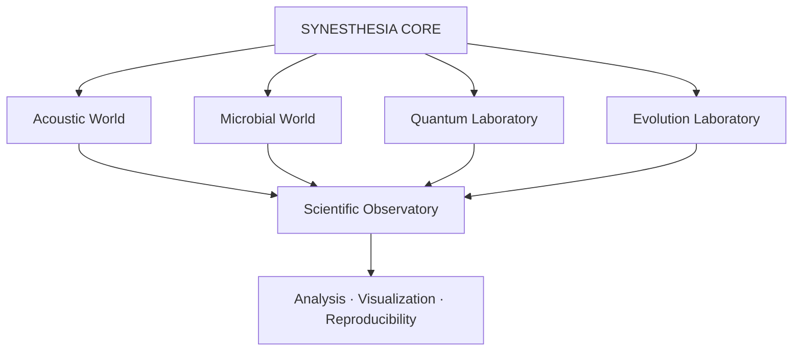

# SYNESTHESIA

<p align="center">
  <strong>Artificial Life & Computational Biology Research Experimental</strong>
</p>

<p align="center">
  An experimental platform exploring how physical, chemical, and evolutionary systems can give rise to organization, adaptation, communication, and life-like behavior.
</p>

<p align="center">
  <code>C++20</code> &nbsp;·&nbsp; <code>Scientific Computing</code> &nbsp;·&nbsp; <code>Artificial Life</code> &nbsp;·&nbsp; <code>Computational Biology</code>
</p>

---

## Overview

**Synesthesia** is an experimental research project investigating the emergence and evolution of complex living systems through computational simulation.

Its long-term objective is to build a modular artificial life laboratory in which physical environments, chemical interactions, genetic variation, and evolutionary pressures can produce increasingly complex forms of organization and behavior.

Rather than implementing predefined organisms, societies, or ecosystems, Synesthesia aims to establish the underlying mechanisms and environmental conditions from which such structures could emerge.

The project begins with an acoustic simulation environment, where digital organisms will eventually interact through physically simulated sound propagation, perception, and communication. Its broader research direction extends toward protocellular systems, evolutionary dynamics, computational models of biological quantum phenomena, and multiscale artificial ecosystems.

Synesthesia is being developed incrementally, with an emphasis on reproducibility, measurable experiments, performance, and scientific transparency.

> **The central question:** Under what conditions can relatively simple systems develop increasingly complex forms of organization, interaction, adaptation, and evolution?

## Research Vision

Synesthesia is organized around several interconnected research domains.

### 01. Acoustic World

An experimental environment for investigating the emergence and evolution of communication.

- Physical acoustic wave propagation.
- Environmental reflection and energy dissipation.
- Artificial sensory systems and sound perception.
- Evolving signal production and communication.
- Learning, adaptation, and behavioral responses.
- Potential emergence of cooperative and competitive signaling.

The objective is to investigate whether meaningful communication can emerge from evolutionary pressures rather than predefined communication protocols.

### 02. Microbial World

A computational environment inspired by early biological and prebiotic systems.

- Virtual molecular interactions.
- Autocatalytic reaction networks.
- Membrane-like compartments.
- Energy and concentration gradients.
- Metabolic organization.
- Compartment growth and division.
- Hereditary information and replication errors.
- Competition and selection between protocellular systems.

This domain aims to investigate conditions under which non-living chemical models can develop properties associated with self-maintenance, reproduction, and Darwinian evolution.

### 03. Quantum Laboratory

A dedicated computational research domain for exploring selected quantum phenomena relevant to biological systems.

Potential areas of investigation include:

- Quantum transport and energy transfer.
- Radical-pair spin dynamics.
- Quantum tunneling in biochemical reactions.
- Coherence and decoherence models.
- Comparisons between classical and quantum-inspired mechanisms.

The objective is to construct mathematically grounded models and investigate their potential functional consequences.

Quantum effects will not be assumed to provide a universal explanation for biological complexity. Their relevance must be evaluated through controlled comparisons and measurable outcomes.

### 04. Evolution Laboratory

A broader environment for investigating evolutionary processes and emergent ecological relationships.

- Genetic variation and inheritance.
- Mutation and natural selection.
- Neuroevolution and behavioral adaptation.
- Coevolution and ecological specialization.
- Population dynamics and migration.
- Speciation and extinction.
- Cooperation, competition, and symbiosis.
- Social organization and collective behavior.

Complex structures should emerge from the interaction of simpler mechanisms, not from predefined social or ecological templates.

### 05. Scientific Observatory

An integrated environment for observing, analyzing, and reproducing experiments.

The long-term vision includes:

- Multiscale simulation visualization.
- Organism and lineage inspection.
- Population and ecological analysis.
- Communication network visualization.
- Genetic and evolutionary history.
- Experiment configuration and comparison.
- Statistical analysis and data export.
- Reproducible simulation snapshots.

The observatory is intended to be an investigative instrument, not merely a graphical interface.

---

## Architecture

Synesthesia is envisioned as a modular platform with a shared computational foundation and independent experimental domains.



### Core Principles

| Principle | Purpose |
|---|---|
| Determinism | Enable repeatable simulations and comparisons. |
| Modularity | Keep experimental domains independently extensible. |
| Reproducibility | Preserve seeds, configurations, and simulation state. |
| Performance | Support computationally intensive experiments. |
| Observability | Make internal processes measurable and inspectable. |
| Scientific integrity | Distinguish hypotheses, model assumptions, and experimental results. |

### Current Technical Foundation

The project is written in **C++20**, using CMake as its build system.

Current implementation includes:

- Deterministic pseudorandom number generation using xoshiro256**.
- Fixed-step simulation infrastructure.
- State hashing and reproducibility tests.
- A lock-free single-producer, single-consumer queue.
- Cache-line separation for queue producer and consumer state.
- Native Win32 window and CPU framebuffer.
- Windows WASAPI audio output.
- Audio callback instrumentation and underrun monitoring.
- Benchmarking infrastructure.
- Optional AddressSanitizer, UndefinedBehaviorSanitizer, and ThreadSanitizer configurations.

The current `ToyWorld` is a temporary deterministic simulation used to validate the foundation. It is not the final acoustic simulation engine.

---

## Current Implementation

**Development stage: Early experimental development**

Synesthesia is being developed through incremental engineering phases.

### Foundation — Completed

- [x] CMake build system.
- [x] C++20 configuration.
- [x] Compiler warning configuration.
- [x] Deterministic xoshiro256** pseudorandom generator.
- [x] Fixed-step simulation interface.
- [x] State hashing.
- [x] Reproducibility testing.
- [x] SPSC lock-free queue.
- [x] Benchmarking infrastructure.
- [x] Optional sanitizer configurations.
- [x] Initial CI workflow configuration.

### Platform and Audio — Implemented, validation ongoing

- [x] Native Win32 window.
- [x] CPU framebuffer.
- [x] WASAPI shared-mode audio output.
- [x] Event-driven audio processing.
- [x] Dedicated audio thread.
- [x] SPSC audio queue integration.
- [x] Basic audio playback.
- [x] Audio callback instrumentation.
- [ ] One-hour audio stress test without underruns.
- [ ] Documented latency measurements under sustained load.

### Planned Simulation Development

- [ ] Two-dimensional FDTD acoustic wave engine.
- [ ] Acoustic sensing and signal emission.
- [ ] Physical environment and fluid coupling.
- [ ] Artificial organisms and biological processes.
- [ ] Neural systems and evolutionary algorithms.
- [ ] Emergent communication experiments.
- [ ] Extended ecological interactions.
- [ ] CPU-based 3D software rasterizer.
- [ ] Scientific observatory and experiment analysis.

Features in this section represent development objectives, not existing functionality.

---

## Experimental Methodology

Scientific reproducibility is a fundamental design requirement.

The project aims to support experiments that can be repeated under controlled conditions, with comparable initial states and measurable outcomes.

Planned experimental capabilities include:

- Explicit simulation seeds.
- Reproducible initial conditions.
- Deterministic execution where supported by the numerical model and execution environment.
- Controlled environmental parameters.
- Baseline and control populations.
- Ablation experiments.
- Repeated trials across different seeds.
- Statistical comparisons.
- Exportable experimental results.

For example, acoustic communication experiments could compare populations with functional acoustic channels against populations in which those channels have been disabled.

Measurements could include information transfer, survival, reproductive success, behavioral changes, and energetic cost.

The purpose is to distinguish genuine adaptation from apparent complexity or coincidental behavior.

**Important:** Synesthesia is a computational research platform. Simulation outcomes are evidence about the behavior of a particular model under specified assumptions, not automatic proof of real-world biological mechanisms.

---

## Benchmarks & Testing

The initial engineering foundation has been tested locally using MinGW GCC 16.2.0 on Windows.

### Automated Tests

| Test | Result |
|---|---|
| `test_config` | PASS |
| `test_rng` | PASS |
| `test_determinism` | PASS |
| `test_spsc` | PASS |

**Result: 4/4 tests passed.**

Total execution time: 1.69 seconds.

The determinism test includes one million simulation steps.

### Initial Simulation Benchmark

Measured using `bench_step` in Release configuration.

| Metric | Result |
|---|---:|
| p50 | 417 ns |
| p90 | 476 ns |
| p99 | 744 ns |
| p99.9 | 977 ns |
| Maximum | 1,174 ns |

Benchmark target: `ToyWorld::step`, measured in batches of 100.

This benchmark measures the temporary simulation foundation, not the future FDTD acoustic engine.

Results are specific to the machine and execution environment used. The processor model was not recorded, so these measurements should not be interpreted as cross-machine performance comparisons.

### Continuous Integration

A GitHub Actions workflow is configured with the following intended matrix:

- Linux / GCC
- Linux / Clang
- Windows / MSVC
- macOS / Clang
- AddressSanitizer and UndefinedBehaviorSanitizer
- ThreadSanitizer

Cross-platform CI execution has not yet been independently verified.

---

## Installation & Build

### Requirements

- CMake 3.20 or newer.
- A C++20-compatible compiler.
- Git.
- Windows for the current native Win32 and WASAPI sandbox.

The core tests and benchmark are built separately from the Windows-specific platform executable.

### Clone the Repository

```bash
git clone https://github.com/FreemanKlay/Synesthesia-Experimental-Proof-Project-Study-Material-.git

cd Synesthesia-Experimental-Proof-Project-Study-Material-
```

### Configure and Build

```bash
cmake -S . -B build -DCMAKE_BUILD_TYPE=Release

cmake --build build -j
```

### Run Automated Tests

```bash
ctest --test-dir build --output-on-failure
```

### Run the Benchmark

```bash
./build/bench_step
```

### Windows / MinGW

For the current Windows development environment using MSYS2 UCRT64:

```powershell
$env:PATH = "C:\msys64\ucrt64\bin;" + $env:PATH
$env:CMAKE_GENERATOR = "MinGW Makefiles"

cmake -S . -B build -DCMAKE_BUILD_TYPE=Release

cmake --build build -j

ctest --test-dir build --output-on-failure

.\build\bench_step.exe
```

### Sanitizer Builds

AddressSanitizer and UndefinedBehaviorSanitizer:

```bash
cmake -S . -B build-san \
  -DSYN_SANITIZE=ON \
  -DCMAKE_BUILD_TYPE=Debug

cmake --build build-san -j

ctest --test-dir build-san --output-on-failure
```

ThreadSanitizer:

```bash
cmake -S . -B build-tsan \
  -DSYN_TSAN=ON \
  -DCMAKE_BUILD_TYPE=Debug

cmake --build build-tsan -j

ctest --test-dir build-tsan --output-on-failure
```

Sanitizer availability depends on the compiler and platform.

---

## Running the Sandbox

The current Windows sandbox provides the native window and basic audio playback.

### Standard Execution

```powershell
.\build\sandbox.exe
```

Opens the window and plays a 440 Hz test tone. Press `ESC` to exit.

### Audio Stress Test

```powershell
.\build\sandbox.exe --seconds 60 --load 8
```

Runs for 60 seconds with eight artificial CPU load threads.

### Extended Audio Test

```powershell
.\build\sandbox.exe --no-window --seconds 3600 --load 8 > soak_audio.txt
```

Runs an extended audio test without opening the window.

The extended test is intended to evaluate audio stability and underruns under sustained load. Its successful completion must be verified separately before claiming the one-hour acceptance criterion.

---

## Project Structure

```text
Synesthesia/
│
├── .github/
│   └── workflows/
│       └── ci.yml
│
├── docs/
│   └── adr/
│       ├── 0001-physical-scale.md
│       └── 0002-audio-output.md
│
├── include/
│   └── syn/
│       ├── bench.hpp
│       ├── config.hpp
│       ├── hash.hpp
│       ├── rng.hpp
│       ├── sim.hpp
│       ├── spsc_queue.hpp
│       └── platform/
│
├── src/
│   └── platform/
│       ├── wasapi_out.cpp
│       └── win32_window.cpp
│
├── tests/
│   ├── test_config.cpp
│   ├── test_determinism.cpp
│   ├── test_rng.cpp
│   └── test_spsc.cpp
│
├── tools/
│   ├── bench_step.cpp
│   └── sandbox.cpp
│
├── CMakeLists.txt
└── README.md
```

The structure will evolve as additional simulation domains and research tools are implemented.

---

## Technical Decisions

Important architectural decisions are documented through Architecture Decision Records (ADRs).

- [ADR-0001 — Physical Scale and CFL Stability](docs/adr/0001-physical-scale.md)
- [ADR-0002 — WASAPI Audio Output and SPSC Queue](docs/adr/0002-audio-output.md)

These documents explain the reasoning behind important engineering decisions, including physical simulation scale, numerical stability, audio output, and real-time processing constraints.

---

## Roadmap

Synesthesia is intended to evolve through independently testable milestones.

| Stage | Direction | Status |
|---|---|---|
| 00 | Engineering foundation | Completed |
| 01 | Native platform and audio | In progress |
| 02 | Acoustic wave simulation | Planned |
| 03 | Physical environment and biological foundations | Planned |
| 04 | Organisms, neural systems, and evolution | Planned |
| 05 | Communication and ecological interactions | Planned |
| 06 | Scientific visualization and analysis | Planned |
| 07 | Multidomain research environments | Long-term vision |

The roadmap is evolutionary rather than fixed. Each stage should establish a reliable foundation before the next major research domain is introduced.

---

## Research Principles

Synesthesia follows a few central principles:

**Emergence over scripting**

Complex behaviors should arise from interactions and evolutionary pressures rather than predefined outcomes.

**Measurement over appearance**

Visually convincing behavior is not sufficient evidence of intelligence, adaptation, communication, or biological organization.

**Reproducibility over isolated demonstrations**

Experiments should be repeatable and their results independently inspectable.

**Scientific caution over extraordinary claims**

Models must distinguish established mechanisms, simplifying assumptions, and speculative hypotheses.

**Modularity over monolithic design**

Different physical and biological scales require appropriate mathematical models and independent simulation domains.

---

## Contributing

Synesthesia is currently an experimental personal research project.

As its architecture and development practices mature, contribution guidelines will be introduced for external developers and researchers.

Technical discussions, well-documented issues, reproducible bug reports, and constructive research suggestions are welcome.

---

## License

A license has not yet been selected.

Until a license is added to the repository, the project's source code remains subject to applicable default copyright protections. Public availability does not automatically grant permission to reuse, modify, or redistribute it.

---

<p align="center">
  <strong>SYNESTHESIA</strong>
  <br>
  <sub>Exploring the computational foundations of artificial life.</sub>
</p>
